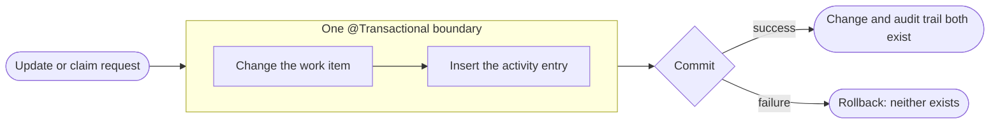
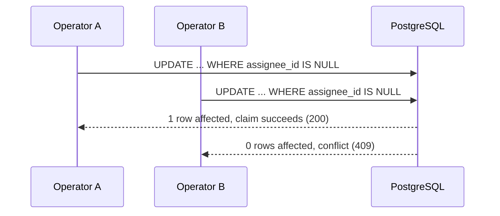
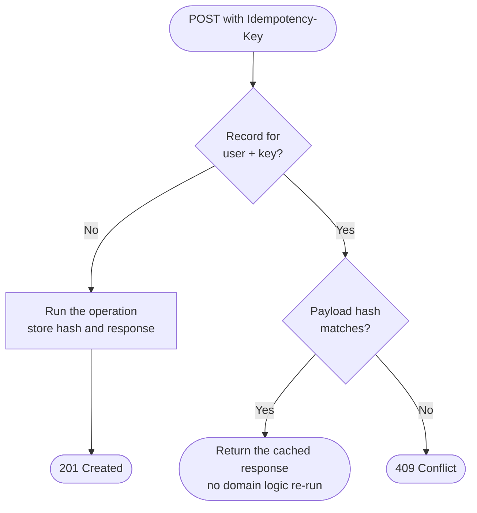
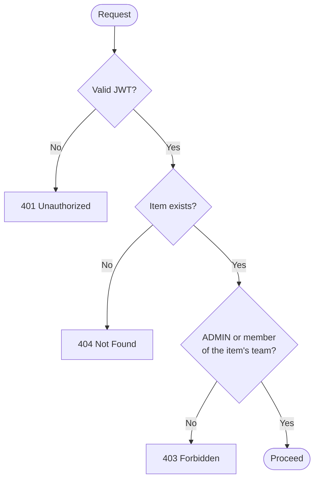

<div align="center">

# Engineering Decisions

**Why Newtonite is built the way it is: five decisions, their alternatives and their trade-offs.**

[README](./README.md) · [Live demo](https://newtonie.vercel.app)

</div>

---

## Contents

- [At a glance](#at-a-glance)
- [Decision 1: Modular monolith with transactional consistency](#decision-1-modular-monolith-with-transactional-consistency)
- [Decision 2: Atomic claiming and optimistic locking](#decision-2-atomic-claiming-and-optimistic-locking)
- [Decision 3: User-scoped idempotency](#decision-3-user-scoped-idempotency)
- [Decision 4: Stateless JWT and a server-enforced team authorization model](#decision-4-stateless-jwt-and-a-server-enforced-team-authorization-model)
- [Decision 5: Honest auth UX, persistent collaboration and a lightweight frontend](#decision-5-honest-auth-ux-persistent-collaboration-and-a-lightweight-frontend)
- [What was intentionally not built](#what-was-intentionally-not-built)
- [What would change at larger scale](#what-would-change-at-larger-scale)

---

## At a glance

| # | Decision | Problem it solves | Core mechanism | Verified by |
|---|---|---|---|---|
| 1 | Modular monolith | Work, comments and audit history must never disagree | One database, shared `@Transactional` boundaries | `WorkItemWorkflowTests`, `WorkItemCommentTests` |
| 2 | Atomic claim and optimistic locking | Two people claiming one item, or overwriting each other's edits | Conditional SQL update, `@Version` plus `If-Match` | `ConcurrentClaimingTests`, `OptimisticLockingTests` |
| 3 | User-scoped idempotency | Retries creating duplicate items | `Idempotency-Key` with SHA-256 payload hash, keyed by `(user_id, key)` | `IdempotencyTests`, `SecurityAuthTests` |
| 4 | Stateless JWT and team authorization | Cross-team data exposure, spoofable identity | Verified principal, team membership checks on every operation | `SecurityAuthTests` |
| 5 | Honest auth UX, persistent comments, lightweight UI | Trustworthy UX without dead features or heavy bundles | Real comments table, no mocked SSO, heavy visuals confined to `/login` | `WorkItemCommentTests` |

---

## Decision 1: Modular monolith with transactional consistency

### Problem

A work item, its comments and its audit trail form one logical unit. If a status change is saved but its audit entry is lost, the history lies. The brief states that important actions must not silently disappear.

### Decision

A modular monolith in Spring Boot 3.5 (Java 25) with explicit domain packages: `com.newtonite.workitem`, `team`, `activity`, `config` and `common`. A domain mutation and its audit entry or comment write share one atomic database transaction (`@Transactional`). Modules talk through explicit Java service contracts. Referential integrity lives in PostgreSQL 16 (foreign keys, `ON DELETE CASCADE` on child logs and comments) and in versioned Flyway migrations.



### Alternatives considered

| Option | Why it was not chosen |
|---|---|
| Microservices per domain | Adds network failure modes, distributed transactions (2PC or saga) and eventual-consistency drift, for a problem that fits one database |
| Asynchronous audit logging | History could lag or be lost if processing failed, which breaks the "history must not disappear" requirement |

### Trade-offs and limitations

- Everything deploys, scales and fails together. This is acceptable for the stated scale, but a single database is a shared point of contention.
- Module boundaries are package-level conventions, not separate deployables. Splitting later is possible but not free.

**Where to look:** `com.newtonite.workitem`, `com.newtonite.activity`, Flyway migrations in `backend/src/main/resources`.

---

## Decision 2: Atomic claiming and optimistic locking

### Problem

Many engineers triage the same queue at once. Two people must not both take ownership of an item, and one person must not silently overwrite another's edit made from an older version.

### Decision

Two complementary mechanisms.

**Atomic claim.** Claiming skips check-then-act and runs as one conditional update:

```sql
UPDATE work_items
SET assignee_id = :userId, updated_at = :now, version = version + 1
WHERE id = :id AND assignee_id IS NULL;
```

PostgreSQL takes a row lock for the update. Exactly one transaction changes the row (`affectedRows == 1`). Every concurrent contender finds `assignee_id IS NOT NULL`, affects zero rows and receives `409 Conflict`.



**Optimistic locking on edits.** Updates are checked twice: by the HTTP `If-Match` precondition (strong numeric ETags or the `*` wildcard) and by the JPA `@Version` column. Weak ETags (`W/"..."`) are rejected for state-changing conditional updates. A stale version returns `409 Conflict`, leaves existing data untouched and writes no misleading audit entry.

**Related workflow rules.** Status changes follow an explicit state machine enforced on the server. `COMPLETED` is terminal, and resubmitting the current status is a no-op that creates no audit entry.

### Alternatives considered

| Option | Why it was not chosen |
|---|---|
| Pessimistic locking (`SELECT ... FOR UPDATE`) | Holds row locks across the request, so contention turns into waiting and lowers throughput |
| Application-level locks | Only protect a single instance, so they fail once more than one backend runs |
| Last write wins | Silently loses updates, the exact failure the brief warns about |

### Trade-offs and limitations

- The losing party gets an error, not a queue. The client has to refetch and retry, and the UI surfaces the conflict with a retry action.
- Optimistic locking assumes conflicts are rare. Under heavy contention on a single hot item, retries would increase.

**Where to look:** `ConcurrentClaimingTests`, `OptimisticLockingTests`, `WorkItemWorkflowTests`.

---

## Decision 3: User-scoped idempotency

### Problem

On an unreliable network, or when a user is unsure whether a click worked, the same create request arrives twice. Without protection that means duplicate items and a cluttered audit trail. A shared key space adds another risk: one operator replaying another's key could read that operator's cached response.

### Decision

The `Idempotency-Key` header on work-item creation is backed by an `idempotency_records` table. Each record stores the endpoint, a SHA-256 hash of the payload, the HTTP status and the serialized response body. In Flyway `V3` the primary key became the composite `(user_id, key)`.



- **Identical retry:** within the expiry window the cached response is returned and no second row is created.
- **Same key, different body:** the hash mismatch is detected and rejected with `409 Conflict`.
- **Operator isolation:** partitioning by `user_id` means Operator B cannot read or replay Operator A's response.

### Alternatives considered

| Option | Why it was not chosen |
|---|---|
| Disable the button in the UI | Does not protect against automated retries, flaky networks or direct API calls |
| Globally scoped keys | Allow cross-user replay and cache poisoning |
| Natural-key uniqueness (for example on title) | Rejects legitimate items with similar content and does not detect payload changes |

### Trade-offs and limitations

- It costs a table lookup and stored response bodies per keyed request, and records need an expiry or cleanup policy as volume grows.
- Idempotency is opt-in: it only protects clients that send the header. The frontend sends it for creates.

**Where to look:** `IdempotencyTests`, the user-scoped idempotency scenario in `SecurityAuthTests`, Flyway `V3`.

---

## Decision 4: Stateless JWT and a server-enforced team authorization model

### Problem

Different teams (for example Acme Studio and Acme Platform) must be isolated from one another. Identity must not be spoofable, and permissions must hold even if someone bypasses the UI and calls the API directly.

### Decision

Spring Security with stateless authentication and authorization checked on every operation.

- **Authentication:** signed HMAC-SHA256 JWTs carrying `sub` (user UUID), `email` and `systemRole`. Password hashes are verified with BCrypt (10 rounds), and plaintext passwords are never stored.
- **Principal resolution:** `SecurityCurrentUserProvider` takes the acting user only from the verified security context. Client-supplied identity headers such as `X-User-Id` are ignored.
- **Authorization matrix:**

| Role | Scope | Cross-team behaviour |
|---|---|---|
| `ADMIN` (system role) | All teams | Not applicable |
| `MEMBER`, `TEAM_LEAD` | Teams in `team_memberships` only | Read, update, claim, comment and audit access return `403`. Assigning to a non-member returns `400` |

- **Query scoping:** unfiltered list queries are automatically limited to `team_id IN (the user's team ids)`. Requesting an unauthorized `teamId` returns `403`.
- **Disclosure policy (403 versus 404):** a foreign team's existing item returns `403`, a non-existent id returns `404`.



### Alternatives considered

| Option | Why it was not chosen |
|---|---|
| Server-side sessions | Need a shared session store and make horizontal scaling harder |
| Hiding controls in the UI only | Not real authorization, and explicitly insufficient per the brief |
| Returning `404` for all foreign items | Hides existence, but makes it harder to tell a broken link from a permissions problem during triage |

### Trade-offs and limitations

- A `403` confirms that a foreign item exists. For an internal tool this was judged acceptable in exchange for clearer triage.
- Stateless JWTs cannot be revoked before expiry without adding a shared blacklist.
- Tokens live in browser storage, which is exposed if XSS occurs. HTTP-only cookies would be stronger.
- Login has no lockout or IP rate limiting yet.

**Where to look:** `SecurityAuthTests` (15 scenarios), `SecurityCurrentUserProvider`.

---

## Decision 5: Honest auth UX, persistent collaboration and a lightweight frontend

### Problem

The interface needs to feel like a credible command center, support real team discussion, and stay truthful about what the system can and cannot do, without heavy client dependencies on the main working screens.

### Decision

- **One auth experience.** A dedicated `/login` route and the in-app re-authentication dialog (`LoginDialog`) share the same `AuthCard` component, so behaviour cannot drift.
- **Session persistence that matches the checkbox.** "Remember session" decides whether the token goes to `localStorage` (survives restarts) or `sessionStorage` (tab only). Switching purges the token from the other store.
- **No fake features.** There are no non-functional OAuth buttons. Enterprise SSO (SAML 2.0 / OIDC) prerequisites are explained plainly. Unsubstantiated badges (`SOC 2 Type II`, `ISO/IEC 27001`) were removed and replaced with guarantees the system actually provides: ACID transactions, ETag preconditions, an append-only audit trail and server-enforced RBAC.
- **Persistent comments.** Comments are stored in a relational `comments` table through a JPA `Comment` entity and `CommentRepository`, using `JOIN FETCH c.author` to avoid N+1 queries. The author always comes from the authenticated principal, content must be non-empty and under 5,000 characters, and results return in `createdAt ASC` order.
- **Server-authoritative frontend state.** React context and a typed API client (`frontend/src/lib/api.ts`) hold only what the server returned. Mutated rows are reconciled with the server response, a failed claim reloads the queue, and any `401` clears the session and opens the sign-in dialog.
- **Lightweight design system.** Shared surface tokens (`.surface-subtle`, `.surface-elevated`, `.surface-overlay`) keep styling consistent. The dashboard uses no WebGL. The only 3D scene (`react-three-fiber`) is confined to `/login`, loaded with a dynamic import, and skipped when the user prefers reduced motion.

### Alternatives considered

| Option | Why it was not chosen |
|---|---|
| Mocked "Sign in with Google/Microsoft" buttons | Dishonest and non-functional without registered OAuth clients |
| Client-only or in-memory comments | Lost on refresh and invisible to teammates |
| Lazy-loaded comment authors (N+1 queries) | Query count grows with every comment shown |
| Loading 3D assets across the whole app | Adds bundle weight to screens where it carries no value |

### Trade-offs and limitations

- No real SSO until OAuth clients are registered with the identity providers.
- Comments appear on refetch, not live. There is no push channel yet.
- The login scene adds JavaScript weight to `/login`, which is the cost of the first-impression visual.

**Where to look:** `WorkItemCommentTests` (5 scenarios), `frontend/src/components/auth/auth-card.tsx`, `frontend/src/lib/auth-context.tsx`, `frontend/src/lib/api.ts`.

---

## What was intentionally not built

| Not built | Reason |
|---|---|
| Enterprise SSO (Google Workspace, Microsoft Entra ID) | Needs registered OAuth clients and tenant configuration. It is disclosed as unconfigured rather than mocked |
| Background or asynchronous processing | The primary flow is synchronous so that audit entries commit atomically with the change |
| Token revocation | Requires shared state (for example Redis), which was out of scope for a one-day build |
| Login rate limiting and lockout | Registration is limited, login is not yet |
| Real-time push updates | Polling or refetch is sufficient for the first usable version |
| Load testing | Not performed. Scale-readiness comes from design (server-side filtering and pagination), not measured throughput |

---

## What would change at larger scale

- **Read path:** profile the list and search queries, add dedicated indexing for text search, and consider read replicas for history tables.
- **Async processing:** introduce an outbox-style queue for notifications and enrichment, with retries and idempotent consumers.
- **Identity:** SSO, HTTP-only cookies, token revocation and login throttling.
- **Real-time:** SSE or WebSocket updates so queues refresh without a manual refetch.
- **Boundaries:** extract a module into its own service only when a concrete scaling or ownership need appears.