<div align="center">

# Newtonite

### Operations work management, built to stay correct under pressure

Track incidents, tasks and bugs across teams with enforced access control,<br/>
an immutable audit trail and safe concurrent updates.

<br/>


<br/>

**[Live demo](https://newtonie.vercel.app)** &nbsp;·&nbsp;
**[Architecture](./docs/ARCHITECTURE.md)** &nbsp;·&nbsp;
**[Engineering decisions](./ENGINEERING_DECISIONS.md)** &nbsp;·&nbsp;
**[Quick start](#quick-start)** &nbsp;·&nbsp;
**[API](#api-reference)**

</div>

<br/>

<table align="center">
  <tr>
    <td align="center"><b>13</b><br/><sub>API endpoints</sub></td>
    <td align="center"><b>5</b><br/><sub>workflow states</sub></td>
    <td align="center"><b>4</b><br/><sub>item types</sub></td>
    <td align="center"><b>4</b><br/><sub>priority levels</sub></td>
    <td align="center"><b>5</b><br/><sub>tested critical behaviours</sub></td>
  </tr>
</table>

---

## Contents

| | | |
|---|---|---|
| [Overview](#overview) | [Authentication and isolation](#authentication-and-isolation) | [Getting started](#quick-start) |
| [Highlights](#highlights) | [Concurrency and correctness](#concurrency-and-correctness) | [Configuration](#configuration) |
| [Challenge requirements](#challenge-requirements) | [Collaboration and history](#collaboration-and-history) | [Testing](#testing) |
| [Architecture](#architecture) | [Search and pagination](#search-and-pagination) | [Deployment](#deployment) |
| [Work-item lifecycle](#work-item-lifecycle) | [Frontend](#frontend) | [Known limitations](#known-limitations) |
| [Capability map](#capability-map) | [API reference](#api-reference) | [Roadmap](#roadmap) |

---

## Overview

Operational work at a growing company tends to live in chat threads, spreadsheets and email. Requests disappear, ownership is unclear, and nobody can say what changed or why.

Newtonite replaces that with a single internal application. Every request is a **work item** with a type, priority, status, owner, due date, discussion thread and an immutable activity trail. Access is enforced **on the server, per team**, and the hard cases are handled deliberately: two people claiming the same item, editing a stale version, or retrying a request that may or may not have succeeded.

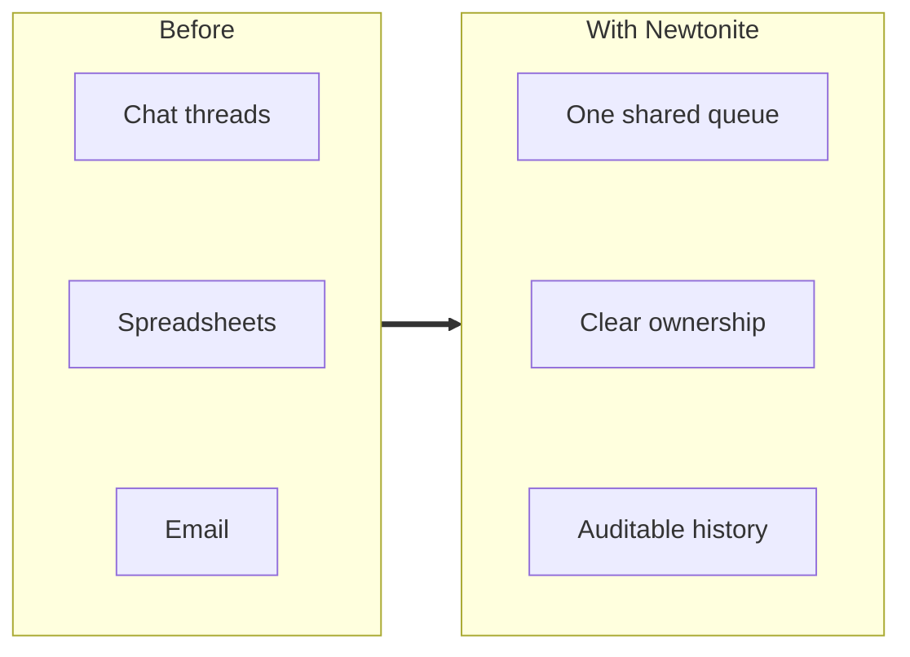

<p align="center">
  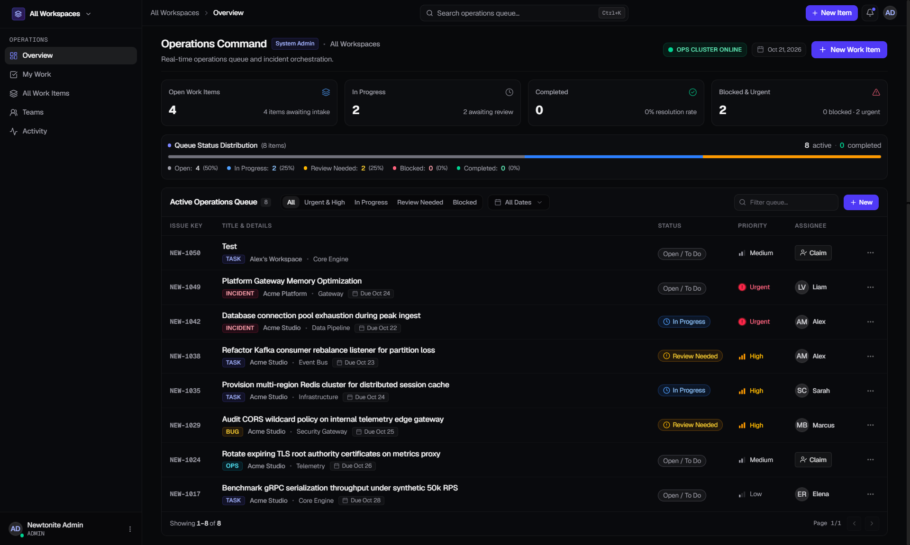
  <br/>
  <sub>The operations dashboard: live counters, status distribution and the filterable queue.</sub>
</p>

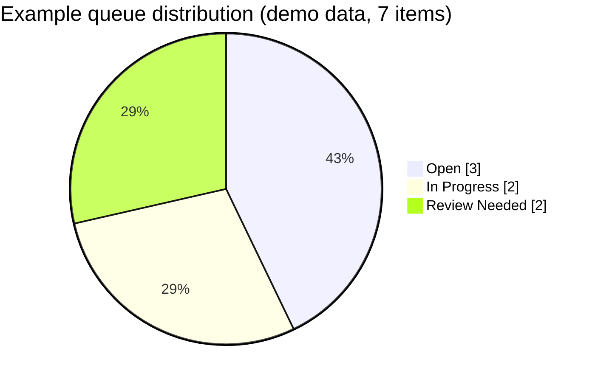

---

## Highlights

<table>
  <tr>
    <td width="33%" valign="top">
      <h4>🔐 Team-scoped access</h4>
      Stateless JWT authentication. Every read and write is authorized on the server against the caller's team memberships. Admins have global access.
    </td>
    <td width="33%" valign="top">
      <h4>🏁 Atomic claiming</h4>
      A claim is one conditional database update. When two operators race, exactly one wins and the other receives <code>409 Conflict</code>.
    </td>
    <td width="33%" valign="top">
      <h4>🔁 Optimistic locking</h4>
      Updates carry the version they were based on. Stale writes are rejected with <code>409</code>, never silently merged.
    </td>
  </tr>
  <tr>
    <td valign="top">
      <h4>🧷 Idempotent creates</h4>
      <code>Idempotency-Key</code> makes retries safe. Keys are scoped per user, and a reused key with a different payload is rejected.
    </td>
    <td valign="top">
      <h4>🧭 Enforced workflow</h4>
      Status changes follow an explicit state machine. <code>COMPLETED</code> is terminal and cannot be reopened by ordinary updates.
    </td>
    <td valign="top">
      <h4>🧾 Immutable audit trail</h4>
      Creation, status, priority and ownership changes are recorded as activity entries, next to a per-item comment thread.
    </td>
  </tr>
  <tr>
    <td valign="top">
      <h4>📈 Built to grow</h4>
      Search, filtering, sorting and pagination run in the database. The browser only ever holds one page of results.
    </td>
    <td valign="top">
      <h4>🎯 Clear overview</h4>
      Live counters, a status-distribution bar and filter tabs show what needs attention first.
    </td>
    <td valign="top">
      <h4>🧪 Tested where it matters</h4>
      Integration tests target the dangerous behaviours: races, stale writes, duplicate requests and cross-team access.
    </td>
  </tr>
</table>

---

## Challenge requirements

Newtonite was built for the *Operations Under Pressure* engineering challenge. This table shows where each requirement is addressed.

| Requirement | How it is addressed |
|---|---|
| Create and manage work items | Create, list, view and partial-update API with typed items (`INCIDENT`, `TASK`, `BUG`, `OPS`) |
| What it is and why it exists | Title, description, type and system area |
| Current state and importance | Status workflow plus `URGENT`, `HIGH`, `MEDIUM`, `LOW` priority |
| Who is responsible | Assignee and reporter on every item, one-click claim for unassigned work |
| What happened previously | Immutable activity history: actor, field, old value, new value |
| What needs attention next | Counters for open, in-progress, blocked and urgent work, queue filters, due dates |
| Teams, identity and access | JWT authentication, team memberships with roles, server-enforced resource-level authorization |
| Collaboration and history | Per-item comments and a paginated audit trail |
| Concurrent usage | Atomic claim, optimistic locking, idempotency |
| Usable at scale | Server-side search, filtering, sorting and bounded pagination |
| Engineering decisions | [`ENGINEERING_DECISIONS.md`](./ENGINEERING_DECISIONS.md) |
| Automated tests | Integration suites for security, concurrency, idempotency and workflow |
| Known limitations | [Listed below](#known-limitations) |

### Behaviours that need more than CRUD

| # | Behaviour | Mechanism | Verified by |
|:-:|---|---|---|
| 1 | Two users claim the same item | Conditional `UPDATE ... WHERE assignee_id IS NULL` | `ConcurrentClaimingTests` |
| 2 | A user edits a stale version | `@Version` with `If-Match` or `expectedVersion` | `OptimisticLockingTests` |
| 3 | A user retries a create | User-scoped `Idempotency-Key` with payload comparison | `IdempotencyTests` |
| 4 | An invalid status jump | Server-side state machine | `WorkItemWorkflowTests` |
| 5 | Access to another team's data | Resource-level team authorization on every operation | `SecurityAuthTests` |

---

## Architecture

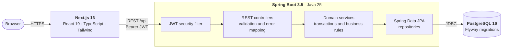

The backend is a **modular monolith**: one deployable with explicit package boundaries, so work, comments and audit history can share transactions and never disagree.

| Package | Responsibility |
|---|---|
| `config` | Security chain, web and CORS configuration |
| `common` | Structured error models and shared infrastructure |
| `workitem` | Work-item entity, service, repository and REST API |
| `team` | Teams, users and team memberships |
| `activity` | Immutable audit log and idempotency records |

> [!TIP]
> For request flows, the data model and the database interaction patterns, see [`ARCHITECTURE.md`](./docs/ARCHITECTURE.md).

---

## Work-item lifecycle

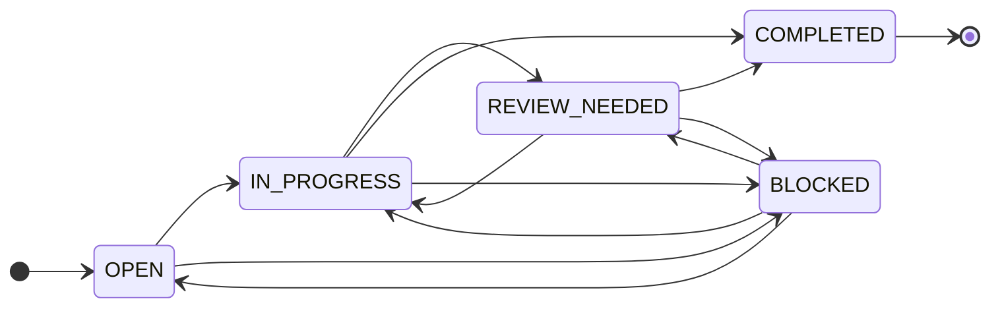

| From | Allowed next states |
|---|---|
| `OPEN` | `IN_PROGRESS`, `BLOCKED` |
| `IN_PROGRESS` | `REVIEW_NEEDED`, `COMPLETED`, `BLOCKED` |
| `REVIEW_NEEDED` | `IN_PROGRESS`, `COMPLETED`, `BLOCKED` |
| `BLOCKED` | `OPEN`, `IN_PROGRESS`, `REVIEW_NEEDED` |
| `COMPLETED` | None. Terminal: reopening returns `409 Conflict` |

Resubmitting an item's current status is accepted as a no-op and does not create an activity entry.

---

## Capability map

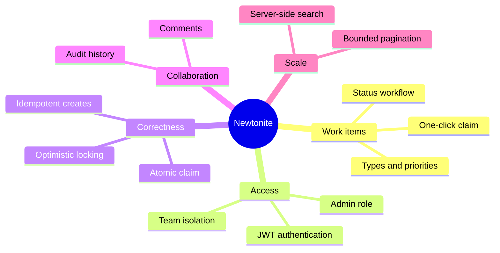

---

## Authentication and isolation

**Authentication.** Stateless Bearer JWT signed with HMAC-SHA256 (`jjwt 0.12.6`). Passwords are hashed with BCrypt (10 rounds). The caller's identity comes only from the verified token. Client-supplied headers such as `X-User-Id` are ignored. Bad credentials return a generic `401` that does not reveal whether an account exists.

**Authorization** is enforced in the backend for every operation, never only in the UI.

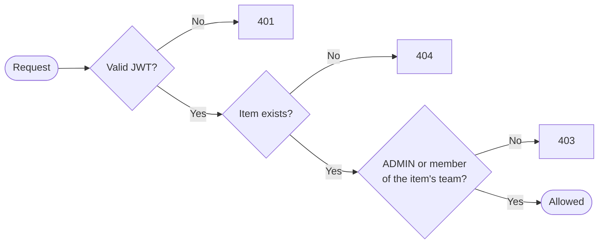

| Rule | Behaviour |
|---|---|
| `ADMIN` system role | Global access across all teams |
| Team members (`MEMBER`, `TEAM_LEAD`) | Restricted to teams they belong to |
| Cross-team read, update, claim, activity, comments | `403 Forbidden` |
| Assigning to someone outside the item's team | `400 Bad Request` |
| `GET /api/work-items?teamId=` for an unauthorized team | `403 Forbidden` |
| Unfiltered list queries | Automatically scoped to the caller's teams |

**Registration.** `POST /api/auth/register` is public and rate-limited per IP. It always creates a least-privileged `USER` with no team memberships, so a new account sees no team data until an administrator assigns it. Public registration cannot create admins or choose teams.

---

## Concurrency and correctness

<table>
  <tr>
    <th width="25%">Scenario</th>
    <th width="35%">Mechanism</th>
    <th width="40%">Outcome</th>
  </tr>
  <tr>
    <td>Two users claim one item</td>
    <td>Single conditional <code>UPDATE</code></td>
    <td>One <code>200</code>, the rest <code>409</code></td>
  </tr>
  <tr>
    <td>Edit from a stale version</td>
    <td><code>@Version</code> plus <code>If-Match</code></td>
    <td><code>409</code>, nothing overwritten, no misleading audit entry</td>
  </tr>
  <tr>
    <td>Retried create request</td>
    <td><code>Idempotency-Key</code> keyed by <code>(user_id, key)</code></td>
    <td>Replay returns the stored response, a changed payload returns <code>409</code></td>
  </tr>
  <tr>
    <td>Invalid status jump</td>
    <td>Server-side state machine</td>
    <td><code>409</code>, <code>COMPLETED</code> is terminal</td>
  </tr>
</table>

### Atomic claim

The database decides the winner with one statement. There is no read-then-write gap and no application-level lock.

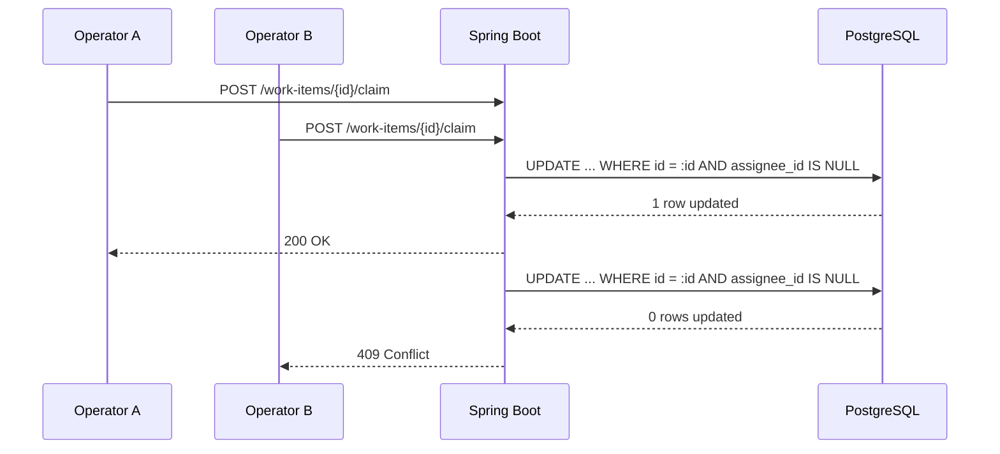

### Optimistic locking

The second writer is rejected instead of overwriting the first. Items carry a JPA `@Version`, and clients send the version they read through `If-Match` or `expectedVersion`.

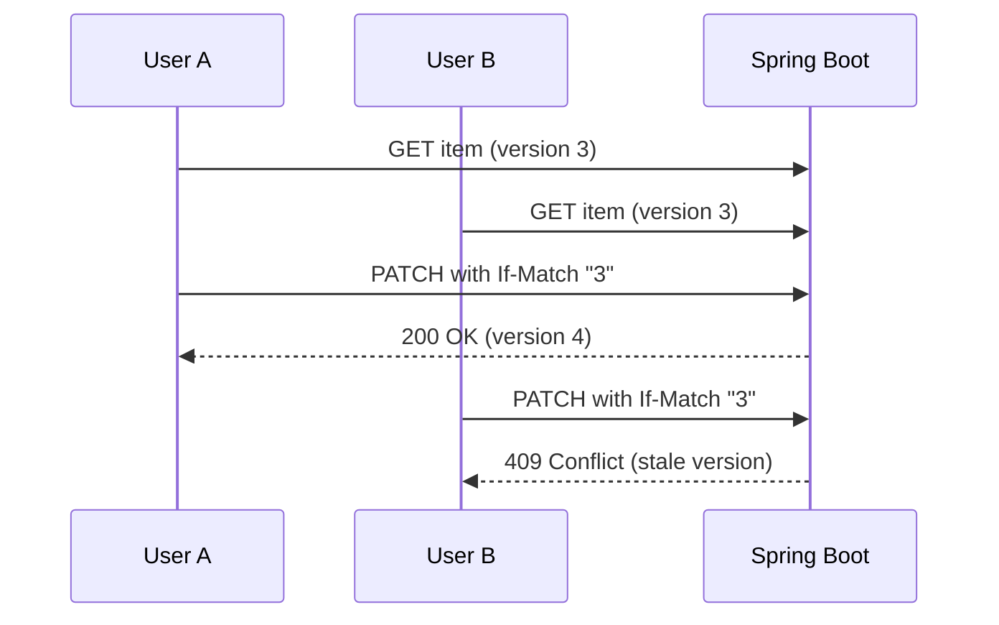

### Idempotent creates

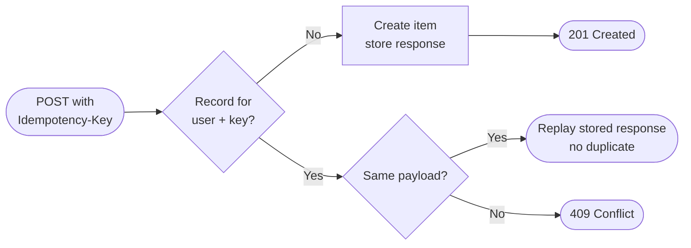

Records use the composite key `(user_id, key)`, so one user's key can never collide with or replay another user's request.

---

## Collaboration and history

| Feature | Details |
|---|---|
| **Activity history** | Every meaningful change (creation, status, priority, ownership) is an immutable entry with actor, field, previous value and new value. Served by a paginated endpoint |
| **Comments** | Each item has a discussion thread. The author always comes from the authenticated principal. Blank content is rejected with `400`. Posting a comment also creates an activity entry |
| **Team rules** | Other teams receive `403`. Admins can comment across teams |
| **Item drawer** | Details, comments and the audit trail in one place in the UI |

---

## Search and pagination

`GET /api/work-items` filters, sorts and pages in the database, so the browser never loads the full dataset.

| Parameter | Purpose |
|---|---|
| `search` | Text search across work items |
| `status` | Filter by status |
| `priority` | One or more priorities, comma-separated (for example `URGENT,HIGH`) |
| `type` | Filter by item type |
| `teamId` | Scope to one team (must be authorized) |
| `assigneeId` | Items assigned to a user (powers "My Work") |
| `systemArea` | Filter by system area |
| `page`, `size` | Bounded pagination |
| `sort` | Sort order, for example `updatedAt,desc` |

Paged responses return `content`, `page`, `size`, `totalElements`, `totalPages`, `first` and `last`.

---

## Frontend

A Next.js 16 App Router application in TypeScript and Tailwind CSS.

| Area | Details |
|---|---|
| Overview | Four live metric cards, a status-distribution bar and the active operations queue |
| Queue | Filter tabs (All, Urgent and High, In Progress, Review Needed, Blocked), debounced server-side search, paginated table, type badges, status pills, priority icons |
| Actions | Create dialog, detail drawer, one-click claim, row menu (copy tracking number, open details) |
| Workspaces | Workspace switcher limited to the user's authorized teams |
| Keyboard | `Ctrl/Cmd + K` focuses search |
| Login | Animated sign-in with a lightweight 3D scene (`react-three-fiber`, `motion`), disabled under `prefers-reduced-motion` |

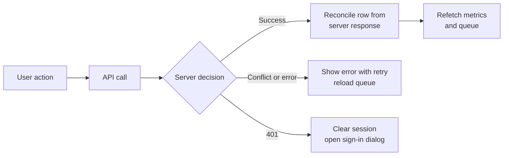

**State management.** The server is the source of truth. The frontend uses React context for authentication and dashboard state, plus a typed API client (`frontend/src/lib/api.ts`).

---

## API reference

Base path `/api`. All endpoints except login, register and health require `Authorization: Bearer <token>`.

| Method | Endpoint | Description |
|:-:|---|---|
| `POST` | `/api/auth/login` | Authenticate and receive a signed JWT |
| `POST` | `/api/auth/register` | Public registration (least privilege, rate-limited) |
| `GET` | `/api/auth/me` | Current user, system role and team memberships |
| `POST` | `/api/work-items` | Create an item. Optional `Idempotency-Key`. Returns `201` with `Location` |
| `GET` | `/api/work-items` | List with search, filters and pagination |
| `GET` | `/api/work-items/metrics` | Dashboard counts (optional `teamId`) |
| `GET` | `/api/work-items/{id}` | Fetch one item |
| `PATCH` | `/api/work-items/{id}` | Partial update with optimistic locking |
| `POST` | `/api/work-items/{id}/claim` | Atomically claim an unassigned item |
| `GET` | `/api/work-items/{id}/activity` | Paginated audit history |
| `GET` | `/api/work-items/{id}/comments` | List comments |
| `POST` | `/api/work-items/{id}/comments` | Add a comment (`{ "content": "..." }`) |
| `GET` | `/actuator/health` | Health probe |

| Status | Meaning |
|:-:|---|
| `200` `201` | Success, created |
| `400` | Validation failure, or assignee is not in the item's team |
| `401` | Missing, invalid or expired token, or bad credentials |
| `403` | Authenticated but not authorized for that team's data |
| `404` | Item not found |
| `409` | Lost claim race, stale version, invalid transition or idempotency conflict |

<details>
<summary><b>Request examples</b></summary>

<br/>

**Create a work item**

```http
POST /api/work-items
Authorization: Bearer <token>
Content-Type: application/json
Idempotency-Key: b7a3e9c1-8452-47e2-8921-2a912d7c0301

{
  "title": "Ingest pipeline memory leak investigation",
  "description": "Investigate heap dump after sustained 10k ingest spikes.",
  "type": "INCIDENT",
  "priority": "URGENT",
  "systemArea": "Data Pipeline",
  "teamId": "aaaaaaaa-aaaa-aaaa-aaaa-aaaaaaaaaaaa",
  "dueDate": "2026-10-25T18:00:00Z"
}
```

**Update with optimistic locking**

```http
PATCH /api/work-items/{id}
Authorization: Bearer <token>
Content-Type: application/json
If-Match: "0"

{ "expectedVersion": 0, "status": "IN_PROGRESS" }
```

A concurrent change by someone else returns `409 Conflict`.

**Claim**

```http
POST /api/work-items/{id}/claim
Authorization: Bearer <token>
```

Exactly one concurrent caller receives `200 OK`. The others receive `409 Conflict`.

</details>

---

## Repository structure

```text
.
├── .env.example               # Documented configuration template
├── compose.yaml               # PostgreSQL 16 for local development
├── docs/                      # Architecture documentation and screenshots
│   ├── ARCHITECTURE.md        # System design, request flows, database interactions
│   └── screenshots/           # Images used in this README
├── ENGINEERING_DECISIONS.md   # Key decisions, alternatives and trade-offs
├── backend/                   # Spring Boot 3.5 modular monolith (Java 25)
│   ├── pom.xml
│   ├── mvnw, mvnw.cmd         # Maven Wrapper
│   └── src/
│       ├── main/java/         # com.newtonite.* (config, common, workitem, team, activity)
│       ├── main/resources/    # application.yml and Flyway migrations
│       └── test/java/         # Integration, concurrency, idempotency and security tests
└── frontend/                  # Next.js 16 + TypeScript + Tailwind CSS
    └── src/
        ├── app/               # App Router pages and layouts
        ├── components/        # Dashboard, work-item, auth and UI components
        └── lib/               # Typed API client, auth context, utilities
```

---

## Quick start

### Prerequisites

| Tool | Version |
|---|---|
| JDK | 25 |
| Docker Desktop | Any recent version (runs PostgreSQL 16) |
| Node.js | 20.9 or newer (required by Next.js 16) |
| npm | Bundled with Node.js |

### Run it locally

**1. Configure the environment**

```bash
cp .env.example .env              # Linux / macOS
```

```powershell
Copy-Item .env.example .env       # Windows PowerShell
```

**2. Start PostgreSQL**

```bash
docker compose up -d
docker compose ps                 # wait until the container is healthy
```

**3. Start the backend** (Flyway migrations run automatically)

```bash
export JAVA_HOME=/path/to/jdk-25  # Linux / macOS
cd backend
./mvnw spring-boot:run
```

```powershell
$env:JAVA_HOME = "C:\path\to\jdk-25"   # Windows PowerShell
cd backend
.\mvnw.cmd spring-boot:run
```

Check <http://localhost:8080/actuator/health>. It should return `{"status":"UP"}`.

**4. Start the frontend**

```bash
cd frontend
npm install
npm run dev
```

Open <http://localhost:3000>.

| Service | Local address |
|---|---|
| Frontend | `http://localhost:3000` |
| Backend API | `http://localhost:8080/api` |
| Health check | `http://localhost:8080/actuator/health` |
| PostgreSQL | `localhost:5433` (database `newtonite`) |

In local development, `/api` requests from the frontend are proxied to the backend.

<details>
<summary><b>Local development accounts</b></summary>

<br/>

Flyway seeds development-only users for local verification. On the local sign-in page, use the **Development Test Accounts** panel to fill credentials with one click.

| Name | Email | System role | Team | Team role |
|---|---|---|---|---|
| Alex Morgan | `alex.morgan@acme.internal` | `ADMIN` | Acme Studio | `TEAM_LEAD` |
| Sarah Chen | `sarah.chen@acme.internal` | `USER` | Acme Studio | `MEMBER` |
| Marcus Bell | `marcus.bell@acme.internal` | `USER` | Acme Studio | `MEMBER` |
| Elena Rostova | `elena.rostova@acme.internal` | `USER` | Acme Studio | `MEMBER` |
| Liam Vance | `liam.vance@acme.internal` | `USER` | Acme Platform | `TEAM_LEAD` |

> [!WARNING]
> These accounts are for local development only. Never use them in a shared or production environment.

</details>

---

## Configuration

Copy [`.env.example`](./.env.example) to `.env`. It documents every variable and separates local defaults from production requirements. Never commit a real `.env`.

| Variable | Used by | Purpose |
|---|---|---|
| `JWT_SECRET` | Backend | HMAC signing secret. Must be a strong unique value outside local development |
| `JWT_EXPIRATION_MS` | Backend | Access-token lifetime in milliseconds |
| `SPRING_DATASOURCE_URL`, `_USERNAME`, `_PASSWORD` | Backend | Database connection |
| `CORS_ALLOWED_ORIGIN` | Backend | Frontend origin allowed to call the API |
| `SECURITY_ADMIN_BOOTSTRAP_ENABLED` | Backend | Provisions an evaluation admin at startup. Off by default |
| `SECURITY_ADMIN_BOOTSTRAP_EMAIL`, `_PASSWORD` | Backend | Credentials for the bootstrapped admin |
| `SECURITY_REGISTRATION_RATE_LIMIT_MAX`, `_WINDOW` | Backend | Registration rate limit per IP |
| `NEXT_PUBLIC_API_URL` | Frontend | API base URL. Defaults to `/api`, proxied to the backend locally |

> [!IMPORTANT]
> Evaluation admin access: reviewer credentials are shared with the submission, not stored in this repository. Enable the bootstrap with `SECURITY_ADMIN_BOOTSTRAP_ENABLED=true` only for the evaluation window, then set it back to `false`.

---

## Testing

Tests target the behaviours that would be most damaging if wrong.

| Suite | What it protects |
|---|---|
| `SecurityAuthTests` | 15 scenarios: login, `401` handling, token expiry, identity-spoofing defense, cross-team read and write isolation (`403`), cross-team assignment rejection (`400`), team filter scoping, user-scoped idempotency |
| `WorkItemCommentTests` | 5 scenarios: team discussion, cross-team denial (`403`), admin cross-team comments, blank-content rejection (`400`), activity logging |
| `ConcurrentClaimingTests` | Simultaneous claims with authenticated actors: only one succeeds |
| `OptimisticLockingTests` | Version conflicts, stale-write rejection, `If-Match` preconditions |
| `IdempotencyTests` | Replay of duplicate requests, payload-mismatch conflicts |
| `WorkItemWorkflowTests` | Full lifecycle, validation, transition rules, audit entries |
| `NewtoniteApplicationTests`, `HealthEndpointTests` | Migrations apply cleanly, health probe responds |

```bash
cd backend
./mvnw test                       # Windows: .\mvnw.cmd test
./mvnw package                    # executable JAR

cd ../frontend
npm run lint
npm run build
```

---

## Deployment

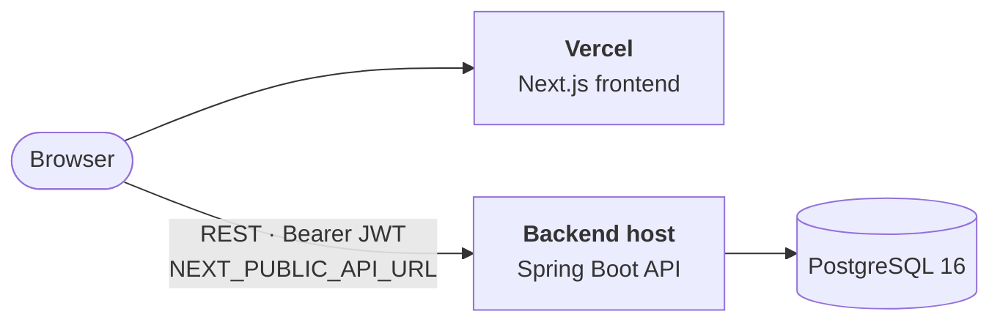

| Component | Host | Notes |
|---|---|---|
| Frontend | Vercel ([newtonie.vercel.app](https://newtonie.vercel.app)) | Set `NEXT_PUBLIC_API_URL` to the deployed backend's `/api` URL |
| Backend | Separate host | Set `JWT_SECRET`, the datasource variables and `CORS_ALLOWED_ORIGIN` in the host's environment settings |
| Database | PostgreSQL 16 | Flyway applies migrations on backend startup |

---

## Known limitations

| Area | Limitation |
|---|---|
| Single sign-on | Google Workspace and Microsoft Entra ID need registered OAuth clients and redirect URIs. It is shown as unconfigured, not mocked |
| Token storage | Short-lived JWTs are kept in `sessionStorage` or `localStorage`. Production should use HTTP-only, `SameSite=Strict` cookies to reduce XSS exposure |
| Token revocation | Stateless JWTs cannot be revoked before expiry without a shared blacklist such as Redis |
| Brute-force protection | Registration is rate-limited. Login has no IP or account lockout yet |
| Secrets | `JWT_SECRET` must come from environment variables or a secret manager |
| Performance evidence | No load testing has been performed. Scale-readiness comes from design (server-side filtering and pagination), not measured throughput |
| Real-time updates | Changes by others appear after a refetch. There is no live push |
| Browser tests | No end-to-end browser tests. Behaviour is covered by backend integration tests and manual testing |

---

## Roadmap

| Area | Next step |
|---|---|
| Security | HTTP-only cookies, login rate limiting and lockout, token revocation, SSO |
| Real-time | Push updates over SSE or WebSocket |
| Async work | Outbox-style queue for notifications and enrichment, with retries and idempotent consumers |
| Scale | Load-test list and search, add search indexing, consider read replicas for history tables |
| Quality | End-to-end browser tests and API contract tests |
| Product | Due-date alerts, saved views and bulk actions |

---

## Documentation

| Document | Contents |
|---|---|
| [`ARCHITECTURE.md`](./docs/ARCHITECTURE.md) | System design, request flows, workspace isolation, database interactions |
| [`ENGINEERING_DECISIONS.md`](./ENGINEERING_DECISIONS.md) | Five key decisions with alternatives and trade-offs |
| [`.env.example`](./.env.example) | Documented configuration template |

<br/>

<div align="center">

Built for the Newtonite Software Engineering Challenge, *Operations Under Pressure*.

</div>