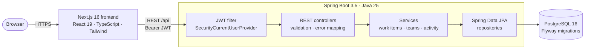
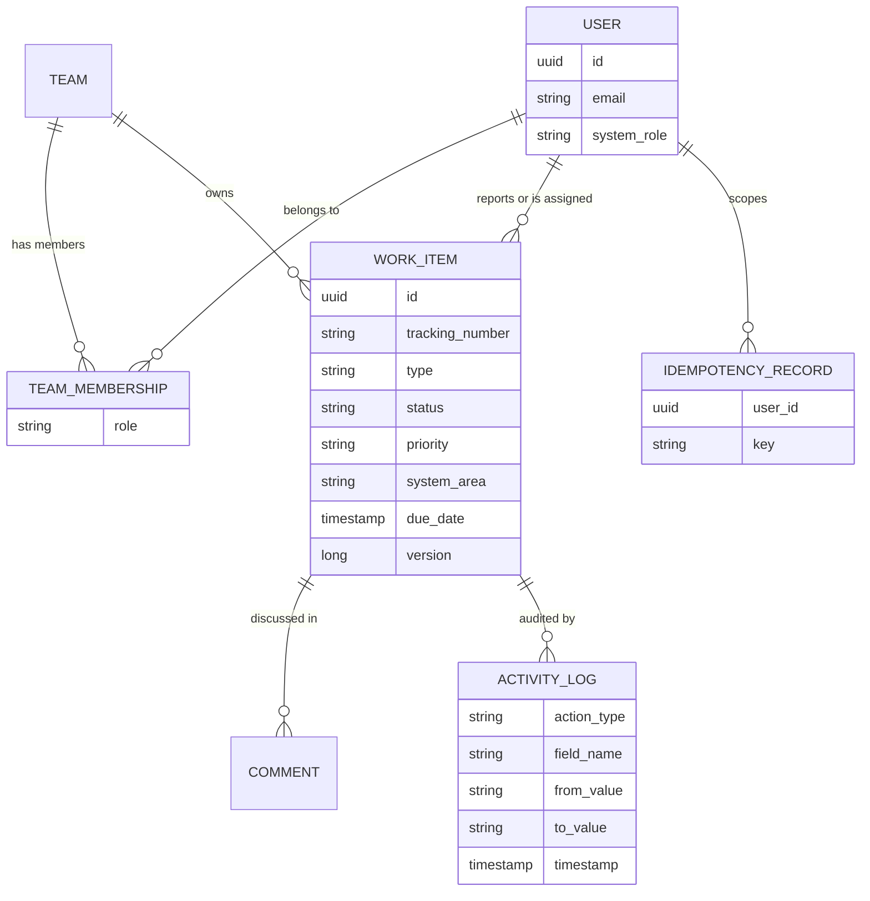
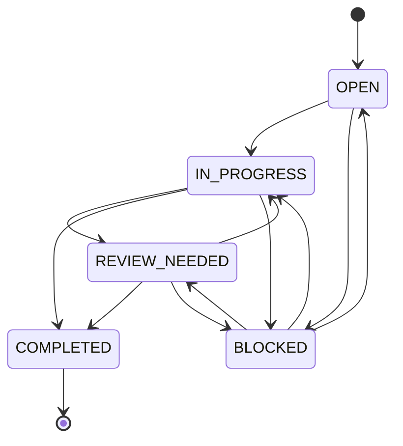
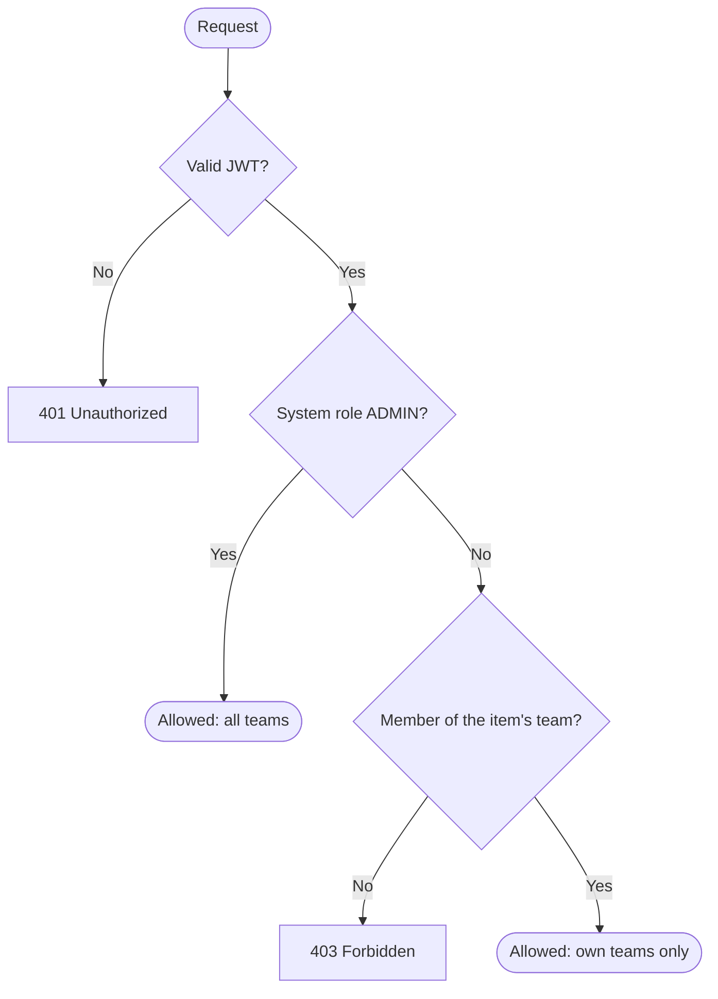
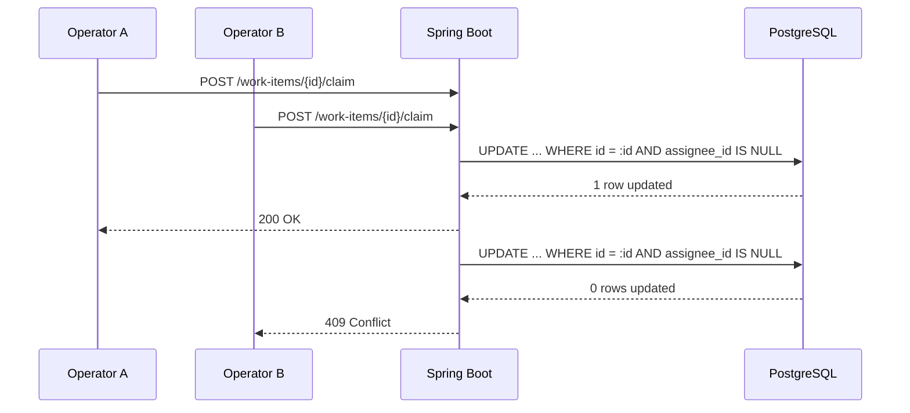
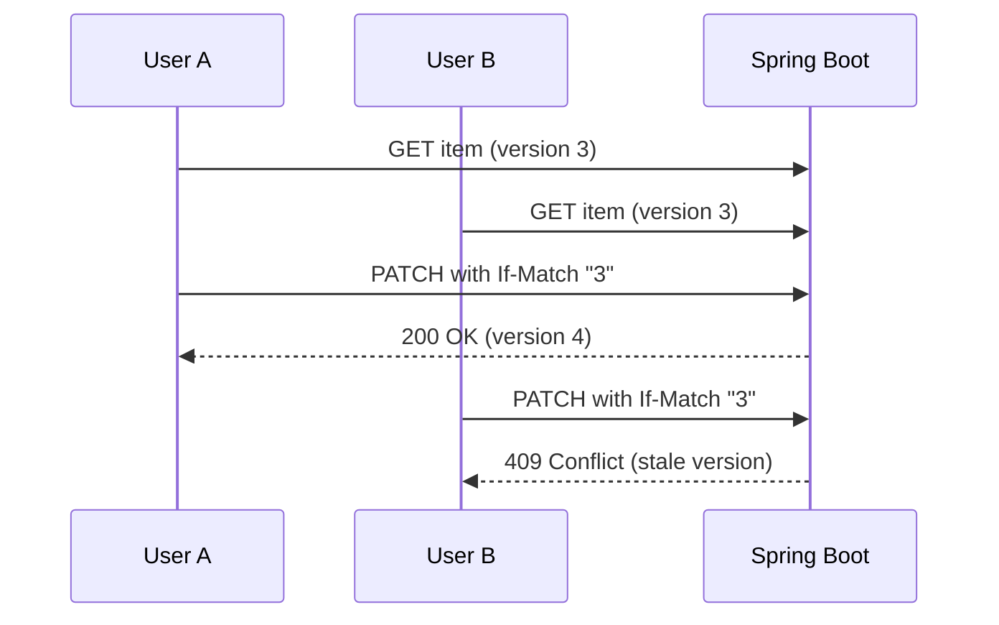
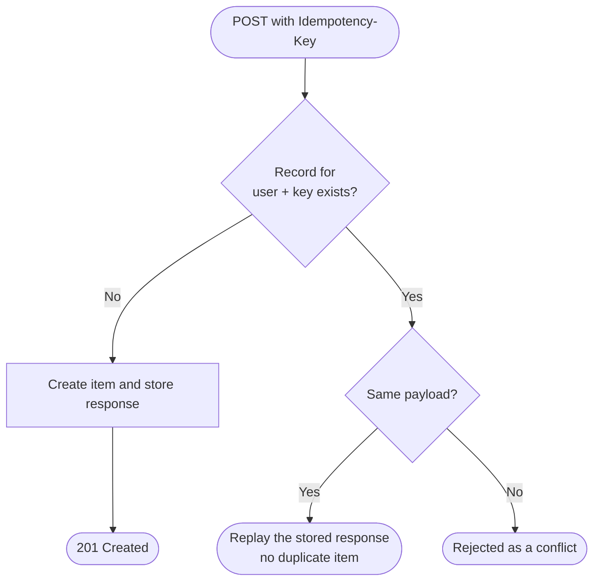

<div align="center">

# Newtonite

**A secure, team-scoped operations work-management platform**
for tracking incidents, tasks and bugs with auditable history and safe concurrent updates.


[Live demo](https://newtonie.vercel.app) · [Engineering decisions](./ENGINEERING_DECISIONS.md) · [API reference](#api-reference) · [Run locally](#getting-started)

</div>

---

## Table of contents

- [Overview](#overview)
- [Highlights](#highlights)
- [How the challenge requirements are met](#how-the-challenge-requirements-are-met)
- [Architecture](#architecture)
- [Data model](#data-model)
- [Work-item lifecycle](#work-item-lifecycle)
- [Authentication and authorization](#authentication-and-authorization)
- [Concurrency and correctness](#concurrency-and-correctness)
- [Collaboration and history](#collaboration-and-history)
- [Search, filtering and pagination](#search-filtering-and-pagination)
- [Frontend](#frontend)
- [API reference](#api-reference)
- [Repository structure](#repository-structure)
- [Getting started](#getting-started)
- [Configuration](#configuration)
- [Testing](#testing)
- [Deployment](#deployment)
- [Known limitations](#known-limitations)
- [Future improvements](#future-improvements)

---

## Overview

Operational work at a growing company often lives in chat threads, spreadsheets and email. Requests disappear, ownership is unclear, and nobody can say what changed or why.

Newtonite replaces that with one internal web application. Every request is a **work item** with a type, priority, status, owner, due date, discussion thread and an immutable activity trail. Access is enforced **on the server, per team**, and the hard cases (two people claiming the same item, editing a stale version, retrying a request) are handled deliberately instead of left to chance.


---

## Highlights

<table>
  <tr>
    <td width="33%" valign="top">
      <b>Team-scoped access</b><br/>
      Stateless JWT auth. Every read and write is authorized server-side against the caller's team memberships. Admins have global access.
    </td>
    <td width="33%" valign="top">
      <b>Atomic claiming</b><br/>
      Claiming is a single conditional database update. When two operators race, exactly one wins and the other gets <code>409 Conflict</code>.
    </td>
    <td width="33%" valign="top">
      <b>Optimistic locking</b><br/>
      Updates carry the version they were based on (<code>If-Match</code> or <code>expectedVersion</code>). Stale writes are rejected, never silently merged.
    </td>
  </tr>
  <tr>
    <td valign="top">
      <b>Idempotent creates</b><br/>
      <code>Idempotency-Key</code> makes retried creates safe. Keys are scoped per user, and a reused key with a different payload is rejected.
    </td>
    <td valign="top">
      <b>Enforced workflow</b><br/>
      Status changes follow an explicit state machine. <code>COMPLETED</code> is terminal and cannot be reopened by ordinary updates.
    </td>
    <td valign="top">
      <b>Immutable audit trail</b><br/>
      Creation, status, priority and ownership changes are recorded as activity entries, alongside a per-item comment thread.
    </td>
  </tr>
  <tr>
    <td valign="top">
      <b>Built to grow</b><br/>
      Search, filtering, sorting and pagination all run on the server. The browser only ever holds one page of results.
    </td>
    <td valign="top">
      <b>Operational overview</b><br/>
      Live counters, a status-distribution bar and a filterable queue show what needs attention first.
    </td>
    <td valign="top">
      <b>Tested where it matters</b><br/>
      Integration tests target the dangerous behaviours: races, stale writes, duplicate requests, cross-team access.
    </td>
  </tr>
</table>

---

## How the challenge requirements are met

| Brief requirement | How Newtonite addresses it |
|---|---|
| Create and manage work items | Full create, list, view and partial-update API with typed items (`INCIDENT`, `TASK`, `BUG`, `OPS`), priorities and due dates |
| What it is and why it exists | Title, description, type and system area on every item |
| Current state and importance | Status workflow (`OPEN` to `COMPLETED`) plus `URGENT` / `HIGH` / `MEDIUM` / `LOW` priority |
| Who is responsible | Assignee and reporter on each item, one-click claim for unassigned work |
| What happened previously | Immutable activity history with actor, field, old value and new value |
| What needs attention next | Dashboard counters for open, in-progress, blocked and urgent work, queue filters and due dates |
| Teams, identity and access | JWT authentication, team memberships with roles, server-enforced resource-level authorization |
| Collaboration and history | Per-item comments and a paginated audit trail |
| Concurrent usage | Atomic claim, optimistic locking and idempotency (see [below](#concurrency-and-correctness)) |
| Usable at scale | Server-side search, filtering, sorting and bounded pagination |
| Engineering decisions | [`ENGINEERING_DECISIONS.md`](./ENGINEERING_DECISIONS.md) |
| Automated tests | Backend integration suites for security, concurrency, idempotency and workflow (see [Testing](#testing)) |
| Known limitations | [Listed below](#known-limitations) |

### Critical behaviours beyond CRUD

| # | Behaviour | Mechanism | Verified by |
|---|---|---|---|
| 1 | Two users claim the same item | Conditional `UPDATE ... WHERE assignee_id IS NULL` | `ConcurrentClaimingTests` |
| 2 | A user edits a stale version | `@Version` plus `If-Match` / `expectedVersion` | `OptimisticLockingTests` |
| 3 | A user retries a create | User-scoped `Idempotency-Key` with payload comparison | `IdempotencyTests` |
| 4 | Invalid status jumps | Server-side state machine | `WorkItemWorkflowTests` |
| 5 | Access to another team's data | Resource-level team authorization on every operation | `SecurityAuthTests` |

---

## Architecture



The backend is a **modular monolith**. One deployable, with clear package boundaries:

| Package | Responsibility |
|---|---|
| `config` | Security, web and CORS configuration |
| `common` | Error models and shared infrastructure |
| `workitem` | Work-item entity, service, repository and REST API |
| `team` | Teams, users and memberships |
| `activity` | Immutable audit logging and idempotency records |

A monolith keeps transactions simple and consistency strong at the scale this system targets, while the package boundaries leave room to split later.

---

## Data model

Simplified conceptual model. The authoritative schema is in the Flyway migrations under `backend/src/main/resources`.



---

## Work-item lifecycle



| From | Allowed next states |
|---|---|
| `OPEN` | `IN_PROGRESS`, `BLOCKED` |
| `IN_PROGRESS` | `REVIEW_NEEDED`, `COMPLETED`, `BLOCKED` |
| `REVIEW_NEEDED` | `IN_PROGRESS`, `COMPLETED`, `BLOCKED` |
| `BLOCKED` | `OPEN`, `IN_PROGRESS`, `REVIEW_NEEDED` |
| `COMPLETED` | None. Terminal state, reopening returns `409 Conflict` |

Resubmitting an item's current status is accepted as a no-op and does not create an activity entry.

---

## Authentication and authorization

**Authentication.** Stateless Bearer JWT signed with HMAC-SHA256 (`jjwt 0.12.6`). Passwords are hashed with BCrypt (10 rounds). The caller's identity comes only from the verified token. Client-supplied identity headers such as `X-User-Id` are ignored. Bad credentials return a generic `401` that does not reveal whether an account exists.

**Authorization.** Enforced in the backend for every operation, never only in the UI.



| Rule | Behaviour |
|---|---|
| `ADMIN` system role | Global access across all teams |
| Team members (`MEMBER`, `TEAM_LEAD`) | Restricted to teams they belong to |
| Cross-team read, update, claim, activity | `403 Forbidden` |
| Assigning to a non-member of the item's team | `400 Bad Request` |
| `GET /api/work-items?teamId=` for an unauthorized team | `403 Forbidden` |
| Unfiltered list queries | Automatically scoped to the caller's teams |

**Registration.** `POST /api/auth/register` is public and rate-limited (10 requests per minute per IP). It always creates a least-privileged `USER` with no team memberships, so new accounts cannot see any team's data until an administrator assigns them. Public registration cannot create admins or choose teams.

---

## Concurrency and correctness

### Atomic claim

Two operators click "Claim" on the same item at the same moment. The claim is one conditional update, so the database decides the winner.



There is no read-then-write gap to race through, and no application-level lock to coordinate.

### Optimistic locking

Two users edit from the same version. The second write is rejected instead of overwriting the first.



Items carry a JPA `@Version`. Clients send the version they read via the `If-Match` header or `expectedVersion` in the body.

### Idempotent creates

A user retries `POST /api/work-items` because they are unsure the first attempt succeeded.



Records use a composite key of `(user_id, key)`, so one user's key can never collide with or replay another user's request.

### Workflow enforcement

Invalid transitions are rejected on the server. Terminal `COMPLETED` items cannot be reopened by ordinary updates.

---

## Collaboration and history

- **Activity history.** Every meaningful change (creation, status, priority, ownership) is written as an immutable entry recording the actor, the field, the previous value and the new value. Available through a paginated endpoint.
- **Comments.** Each item has a discussion thread. Posting a comment also generates an activity entry. Team isolation applies: other teams get `403`, admins can comment across teams, blank content is rejected with `400`.
- **Item drawer.** The UI shows the details, comments and audit trail for an item in one place.

---

## Search, filtering and pagination

`GET /api/work-items` supports the following query parameters. All filtering, sorting and paging happens in the database, so the browser never loads the full dataset.

| Parameter | Purpose |
|---|---|
| `search` | Text search across work items |
| `status` | Filter by status |
| `priority` | Filter by one or more priorities (comma-separated, for example `URGENT,HIGH`) |
| `type` | Filter by item type |
| `teamId` | Scope to one team (must be authorized) |
| `assigneeId` | Items assigned to a user (powers "My Work") |
| `systemArea` | Filter by system area |
| `page`, `size` | Bounded pagination |
| `sort` | Sort order, for example `updatedAt,desc` |

Paged responses return `content`, `page`, `size`, `totalElements`, `totalPages`, `first` and `last`.

---

## Frontend

A Next.js 16 App Router application in TypeScript and Tailwind CSS.

| Area | Details |
|---|---|
| Overview | Four live metric cards, a status-distribution bar and the active operations queue |
| Queue | Filter tabs (All, Urgent and High, In Progress, Review Needed, Blocked), debounced server-side search, paginated table, type badges, status pills, priority icons |
| Actions | Create dialog, detail drawer, one-click claim, row menu (copy tracking number, open details) |
| Workspaces | Workspace switcher scoped to the user's authorized teams |
| Keyboard | `Ctrl/Cmd + K` focuses search |
| Login | Animated sign-in page with a lightweight 3D scene (`react-three-fiber`, `motion`), disabled under `prefers-reduced-motion` |

**State management.** The server is the source of truth. The frontend uses React context for authentication and dashboard state, plus a typed API client (`frontend/src/lib/api.ts`). After a mutation, the changed row is reconciled with the server's response and metrics are refetched. If a claim fails, the queue reloads and the error is shown with a retry. A `401` from any call clears the session and opens the sign-in modal.

---

## API reference

Base path: `/api`. All endpoints except login, register and health require `Authorization: Bearer <token>`.

### Endpoints

| Method | Endpoint | Description |
|---|---|---|
| `POST` | `/api/auth/login` | Authenticate and receive a signed JWT |
| `POST` | `/api/auth/register` | Public registration (least privilege, rate-limited) |
| `GET` | `/api/auth/me` | Current user, system role and team memberships |
| `POST` | `/api/work-items` | Create an item. Optional `Idempotency-Key`. Returns `201` with `Location` |
| `GET` | `/api/work-items` | List with search, filters and pagination |
| `GET` | `/api/work-items/metrics` | Counts for the dashboard (optional `teamId`) |
| `GET` | `/api/work-items/{id}` | Fetch one item |
| `PATCH` | `/api/work-items/{id}` | Partial update with optimistic locking |
| `POST` | `/api/work-items/{id}/claim` | Atomically claim an unassigned item |
| `GET` | `/api/work-items/{id}/activity` | Paginated audit history |
| `GET` | `/api/work-items/{id}/comments` | List comments |
| `POST` | `/api/work-items/{id}/comments` | Add a comment (`{ "content": "..." }`) |
| `GET` | `/actuator/health` | Health probe |

### Status codes

| Code | Meaning |
|---|---|
| `200` / `201` | Success / created |
| `400` | Validation failure, or assignee is not a member of the item's team |
| `401` | Missing, invalid or expired token, or bad credentials |
| `403` | Authenticated but not authorized for this team's data |
| `404` | Item not found |
| `409` | Lost a claim race, stale version, invalid transition, or idempotency conflict |

### Example: create a work item

```http
POST /api/work-items
Authorization: Bearer <token>
Content-Type: application/json
Idempotency-Key: b7a3e9c1-8452-47e2-8921-2a912d7c0301

{
  "title": "Ingest pipeline memory leak investigation",
  "description": "Investigate heap dump after sustained 10k ingest spikes.",
  "type": "INCIDENT",
  "priority": "URGENT",
  "systemArea": "Data Pipeline",
  "teamId": "aaaaaaaa-aaaa-aaaa-aaaa-aaaaaaaaaaaa",
  "dueDate": "2026-10-25T18:00:00Z"
}
```

### Example: update with optimistic locking

```http
PATCH /api/work-items/{id}
Authorization: Bearer <token>
Content-Type: application/json
If-Match: "0"

{ "expectedVersion": 0, "status": "IN_PROGRESS" }
```

A concurrent change by someone else returns `409 Conflict`.

### Example: claim

```http
POST /api/work-items/{id}/claim
Authorization: Bearer <token>
```

Exactly one concurrent caller receives `200 OK`. The others receive `409 Conflict`.

---

## Repository structure

```text
.
├── .env.example               # Safe local configuration defaults
├── compose.yaml               # PostgreSQL 16 for local development
├── ENGINEERING_DECISIONS.md   # Key decisions, trade-offs and rationale
├── docs/screenshots/          # Images used in this README
├── backend/                   # Spring Boot 3.5 modular monolith (Java 25)
│   ├── pom.xml
│   ├── mvnw, mvnw.cmd         # Maven Wrapper
│   └── src/
│       ├── main/java/         # com.newtonite.* (config, common, workitem, team, activity)
│       ├── main/resources/    # application.yml and Flyway migrations
│       └── test/java/         # Integration, concurrency, idempotency and security tests
└── frontend/                  # Next.js 16 + TypeScript + Tailwind CSS
    └── src/
        ├── app/               # App Router pages and layouts
        ├── components/        # Dashboard, work-item, auth and UI components
        └── lib/               # Typed API client, auth context, utilities
```

---

## Getting started

### Prerequisites

| Tool | Version |
|---|---|
| JDK | 25 |
| Docker Desktop | Any recent version (runs PostgreSQL 16) |
| Node.js | 20.9 or newer (required by Next.js 16) |
| npm | Bundled with Node.js |

### 1. Configure the environment

```bash
# Linux / macOS
cp .env.example .env
```

```powershell
# Windows PowerShell
Copy-Item .env.example .env
```

Local defaults: PostgreSQL on host port `5433`, database `newtonite`, API on `http://localhost:8080/api`, frontend on `http://localhost:3000`.

### 2. Start PostgreSQL

```bash
docker compose up -d
docker compose ps        # wait until the container is healthy
```

### 3. Start the backend

Flyway migrations run automatically on startup.

```bash
# Linux / macOS
export JAVA_HOME=/path/to/jdk-25
cd backend
./mvnw spring-boot:run
```

```powershell
# Windows PowerShell
$env:JAVA_HOME = "C:\path\to\jdk-25"
cd backend
.\mvnw.cmd spring-boot:run
```

Verify: <http://localhost:8080/actuator/health> returns `{"status":"UP"}`.

### 4. Start the frontend

```bash
cd frontend
npm install
npm run dev
```

Open <http://localhost:3000>. In local development, `/api` requests are proxied to `http://localhost:8080`.

### Local development accounts

Flyway seeds development-only users for local verification. On the local sign-in page, use the **Development Test Accounts** panel to fill credentials with one click.

| Name | Email | System role | Team | Team role |
|---|---|---|---|---|
| Alex Morgan | `alex.morgan@acme.internal` | `ADMIN` | Acme Studio | `TEAM_LEAD` |
| Sarah Chen | `sarah.chen@acme.internal` | `USER` | Acme Studio | `MEMBER` |
| Marcus Bell | `marcus.bell@acme.internal` | `USER` | Acme Studio | `MEMBER` |
| Elena Rostova | `elena.rostova@acme.internal` | `USER` | Acme Studio | `MEMBER` |
| Liam Vance | `liam.vance@acme.internal` | `USER` | Acme Platform | `TEAM_LEAD` |

> [!WARNING]
> These accounts exist for local development only. Never use them in a shared or production environment.

---

## Configuration

| Variable | Used by | Purpose |
|---|---|---|
| `JWT_SECRET` | Backend | HMAC signing secret. Must be set to a strong value outside local development |
| `SECURITY_ADMIN_BOOTSTRAP_ENABLED` | Backend | Enables startup provisioning of an evaluation admin account. Off by default |
| `SECURITY_ADMIN_BOOTSTRAP_PASSWORD` | Backend | Password for the bootstrapped admin. Supply it through the host's secret settings |
| `NEXT_PUBLIC_API_URL` | Frontend | API base URL. Defaults to `/api`, which is proxied to `http://localhost:8080` locally |

Database connection and port settings are documented in [`.env.example`](./.env.example). It contains placeholders and local defaults only. Never commit a real `.env`.

### Evaluation admin account

For reviewers, an admin account can be provisioned at startup without hardcoding credentials in the repository:

1. Set `SECURITY_ADMIN_BOOTSTRAP_ENABLED=true` and `SECURITY_ADMIN_BOOTSTRAP_PASSWORD` on the backend host.
2. The bootstrap is idempotent. If the account already exists it is left untouched.
3. After evaluation, set `SECURITY_ADMIN_BOOTSTRAP_ENABLED=false` to disable provisioning.

Reviewer credentials are shared with the submission, not stored in this repository.

---

## Testing

Tests target the behaviours that would be most damaging if wrong.

| Suite | What it protects |
|---|---|
| `SecurityAuthTests` | 15 scenarios: login, 401 handling, token expiry, identity-spoofing defense, cross-team read and write isolation (403), cross-team assignment rejection (400), team filter scoping, user-scoped idempotency |
| `WorkItemCommentTests` | 5 scenarios: team discussion, cross-team denial (403), admin cross-team comments, blank-content rejection (400), activity logging |
| `ConcurrentClaimingTests` | Simultaneous claims with authenticated actors, so only one succeeds |
| `OptimisticLockingTests` | Version conflicts and stale-write rejection, `If-Match` preconditions |
| `IdempotencyTests` | Replay of duplicate requests, payload-mismatch conflicts |
| `WorkItemWorkflowTests` | Full lifecycle, validation, transition rules and audit entries |
| `NewtoniteApplicationTests`, `HealthEndpointTests` | Migrations apply cleanly, health probe responds |

```bash
# Backend: full test suite
cd backend
./mvnw test              # Windows: .\mvnw.cmd test

# Backend: executable JAR
./mvnw package

# Frontend: lint and production build
cd frontend
npm run lint
npm run build
```

---

## Deployment

| Component | Host | Notes |
|---|---|---|
| Frontend | Vercel ([newtonie.vercel.app](https://newtonie.vercel.app)) | Set `NEXT_PUBLIC_API_URL` to the deployed backend's `/api` URL |
| Backend | Separate host (Render) | Set `JWT_SECRET`, the database connection and, if needed, the `SECURITY_ADMIN_BOOTSTRAP_*` variables |
| Database | Managed PostgreSQL 16 | Flyway applies migrations on backend startup |

Configure CORS on the backend to allow the frontend's origin.

---

## Known limitations

| Area | Limitation |
|---|---|
| Single sign-on | Google Workspace and Microsoft Entra ID SSO need registered OAuth clients and redirect URIs. It is shown as unconfigured, not mocked |
| Token storage | Short-lived JWTs are kept in `sessionStorage` or `localStorage`. Production should use HTTP-only, `SameSite=Strict` cookies to reduce XSS exposure |
| Token revocation | Stateless JWTs cannot be revoked before expiry without a shared blacklist (for example Redis) |
| Brute-force protection | Login has no IP or account lockout. Registration is rate-limited, login is not |
| Secrets | `JWT_SECRET` must come from environment variables or a secret manager, not the local fallback |
| Performance evidence | No load testing has been performed. Scale-readiness comes from design (server-side filtering and pagination), not measured throughput |
| Real-time updates | Other users' changes appear after a refresh or refetch. There is no live push |
| Browser automation | End-to-end browser tests are not included. Behaviour is verified through backend integration tests and manual testing |

---

## Future improvements

If the system grew significantly, or with another week of work:

- **Security:** move tokens to HTTP-only cookies, add login rate limiting and lockout, add token revocation, and integrate SSO.
- **Real-time:** push updates over SSE or WebSocket so users see changes without refreshing.
- **Asynchronous work:** add an outbox-style queue for notifications and enrichment, with retries and idempotent consumers.
- **Scale:** load-test the list and search endpoints, add search indexing for text queries, and consider read replicas for the history tables.
- **Quality:** add end-to-end browser tests and contract tests for the API.
- **Product:** SLA and due-date alerts, saved views, and bulk actions.

---

<div align="center">

Built for the Newtonite Software Engineering Challenge, *Operations Under Pressure*.
See [`ENGINEERING_DECISIONS.md`](./ENGINEERING_DECISIONS.md) for the reasoning behind the key trade-offs.

</div>