

# Newtonite Architecture

**How the system is structured, how a request travels through it, and how it stays correct under concurrent use.**

[README](../README.md) · [Engineering decisions](../ENGINEERING_DECISIONS.md) · [Live demo](https://newtonie.vercel.app)

---

## Contents

- [System at a glance](#system-at-a-glance)
- [System architecture](#system-architecture)
- [Backend structure](#backend-structure)
- [Request flows](#request-flows)
- [Authentication](#authentication)
- [Workspace isolation](#workspace-isolation)
- [Concurrency control](#concurrency-control)
- [Database interactions](#database-interactions)
- [Frontend architecture](#frontend-architecture)
- [Error handling](#error-handling)
- [Security controls](#security-controls)
- [Deployment topology](#deployment-topology)
- [Quality attributes](#quality-attributes)
- [Scaling path](#scaling-path)

---

## System at a glance

| Layer | Technology | Responsibility |
|---|---|---|
| Frontend | Next.js 16 (App Router), React 19, TypeScript, Tailwind CSS | Dashboard, queue, item drawer, sign-in. Holds no authority over data |
| API | Spring Boot 3.5, Java 25, Spring Security | Authentication, authorization, validation, business rules |
| Persistence | PostgreSQL 16, Spring Data JPA, Flyway | Source of truth, transactions, versioned schema |
| Identity | Stateless JWT (HMAC-SHA256), BCrypt | Who the caller is, verified on every request |

**Guiding principle:** the server is authoritative. The UI only reflects what the API allows, so every rule (access, workflow, concurrency) is enforced in the backend and the database.

---

## System architecture

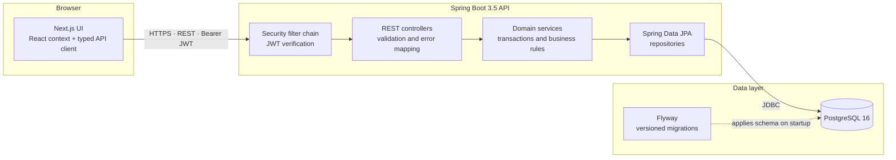

---

## Backend structure

The backend is a modular monolith. Each package owns one part of the domain, and dependencies flow downward.

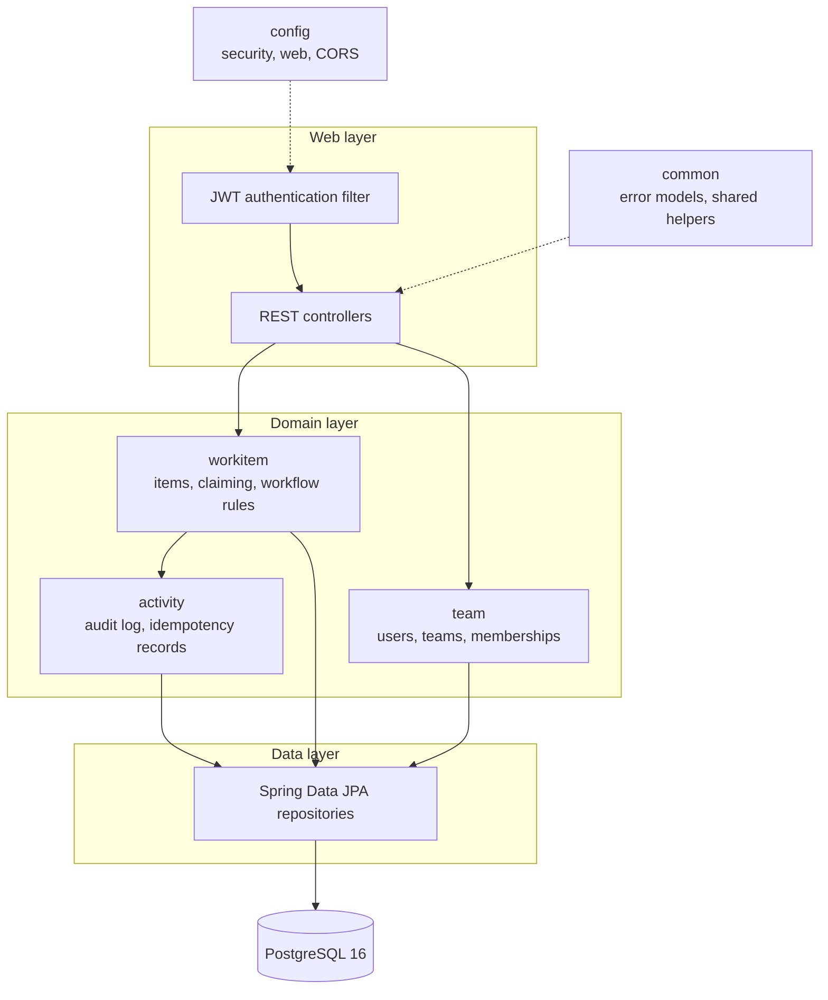

| Package | Responsibility |
|---|---|
| `config` | Security chain, web and CORS configuration |
| `common` | Structured error models and shared infrastructure |
| `workitem` | Work-item entity, service, repository and REST API |
| `team` | Teams, users and team memberships |
| `activity` | Immutable audit log and idempotency records |

---

## Request flows

Every authenticated request follows the same path: **JWT filter, controller validation, service (transaction and authorization), repository, database**. The flows below show what differs per operation.

### 1. Sign in

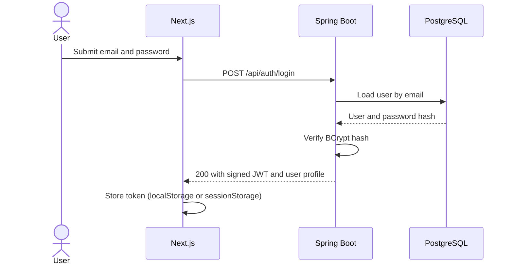

On a later page load, the frontend finds the stored token and calls `GET /api/auth/me` to restore the session. Invalid credentials return a generic `401` that does not reveal whether the account exists.

### 2. List and search work items

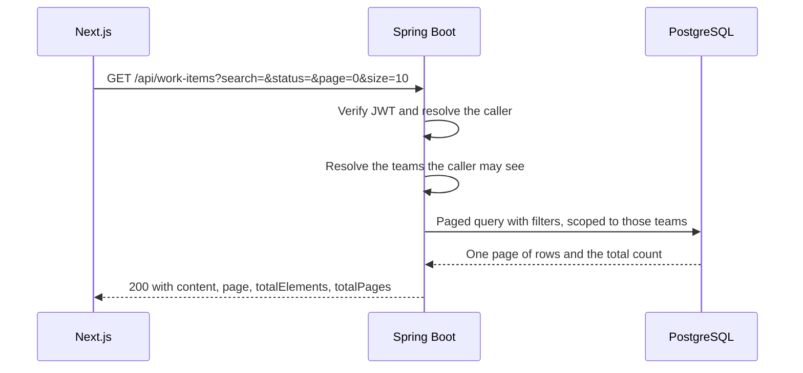

Filtering, sorting and paging happen in the database. The browser never receives more than one page.

### 3. Create a work item (idempotent)

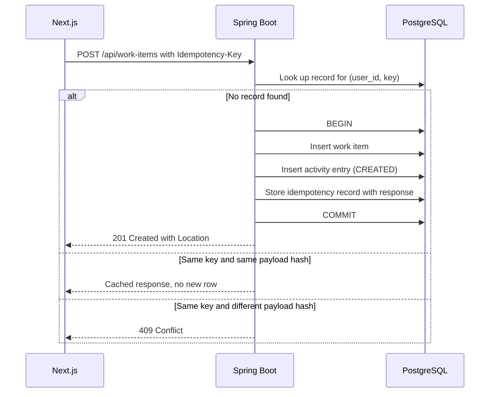

### 4. Update with optimistic locking

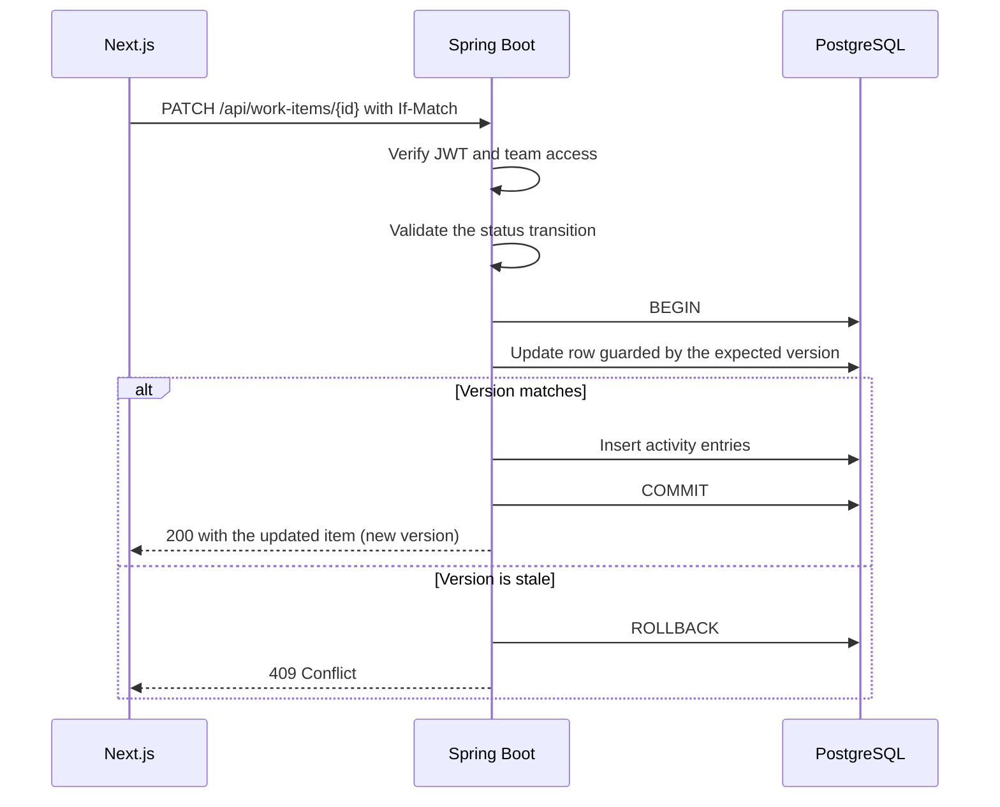

### 5. Claim a work item

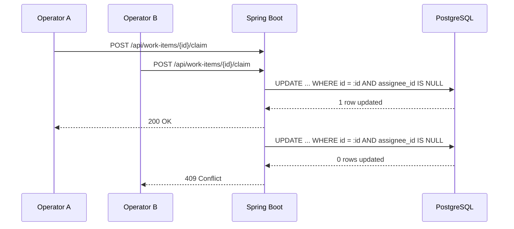

### 6. Comment on a work item

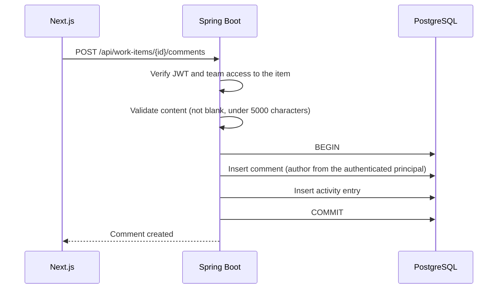

---

## Authentication

| Aspect | Implementation |
|---|---|
| Scheme | Stateless Bearer JWT, signed with HMAC-SHA256 (`jjwt 0.12.6`) |
| Claims | `sub` (user UUID), `email`, `systemRole` |
| Passwords | BCrypt, 10 rounds. Plaintext is never stored |
| Identity source | `SecurityCurrentUserProvider` reads the verified security context. Headers such as `X-User-Id` are ignored |
| Session storage (client) | `localStorage` when "Remember session" is checked, otherwise `sessionStorage`. Switching purges the other store |
| Expiry | Configurable through `JWT_EXPIRATION_MS` |
| Expired or invalid token | `401`. The frontend clears the session and opens the sign-in dialog |
| Registration | `POST /api/auth/register`. Always creates a least-privileged `USER` with no teams. Rate-limited per IP |

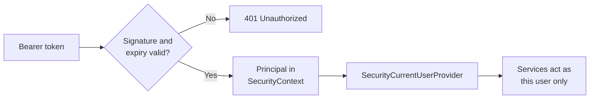

---

## Workspace isolation

Teams are isolated on the server. Hiding controls in the UI is a convenience, never the protection.

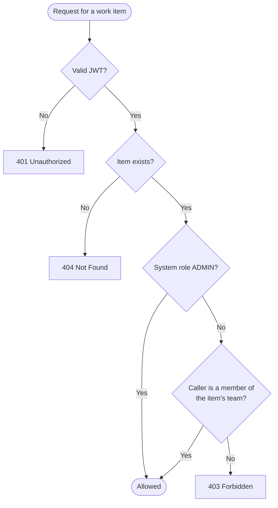

| Enforcement point | Behaviour |
|---|---|
| Single-item read, update, claim | `403` when the item belongs to a team the caller is not in |
| Activity history and comments | Same team check as the item. Admins may access across teams |
| List queries (no filter) | Automatically limited to the caller's teams |
| List queries with `teamId` | `403` if the caller is not authorized for that team |
| Assignment | `400` if the assignee is not a member of the item's team |
| New accounts | Created with no memberships, so they see no team data until an administrator assigns them |

The workspace switcher in the sidebar only chooses which of the caller's already-authorized teams to filter by. The server re-checks every request regardless.

---

## Concurrency control

| Scenario | Mechanism | Outcome | Verified by |
|---|---|---|---|
| Two users claim the same item | Single conditional `UPDATE ... WHERE assignee_id IS NULL` | One `200`, the rest `409` | `ConcurrentClaimingTests` |
| Edit from a stale version | JPA `@Version` plus `If-Match` or `expectedVersion` | `409`, no data overwritten, no misleading audit entry | `OptimisticLockingTests` |
| Retried create request | `Idempotency-Key`, keyed by `(user_id, key)` with SHA-256 payload hash | Replay returns the stored response, a changed payload returns `409` | `IdempotencyTests` |
| Invalid status jump | Server-side state machine | `409`, `COMPLETED` is terminal | `WorkItemWorkflowTests` |
| Change and audit trail disagree | Shared `@Transactional` boundary | Both commit or neither does | `WorkItemWorkflowTests` |

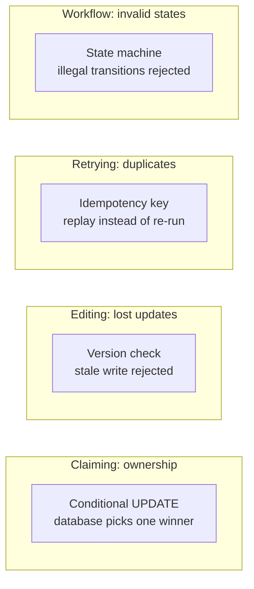

The strategy is **optimistic by default**: no long-held locks, and conflicts are detected at write time and returned to the client as `409`. Claiming avoids a read-then-write gap entirely by letting one SQL statement decide.

Weak ETags (`W/"..."`) are rejected for state-changing conditional updates. Only strong numeric ETags or the `*` wildcard are accepted.

---

## Database interactions

### Conceptual model

Simplified. The authoritative schema is in the Flyway migrations under `backend/src/main/resources`.

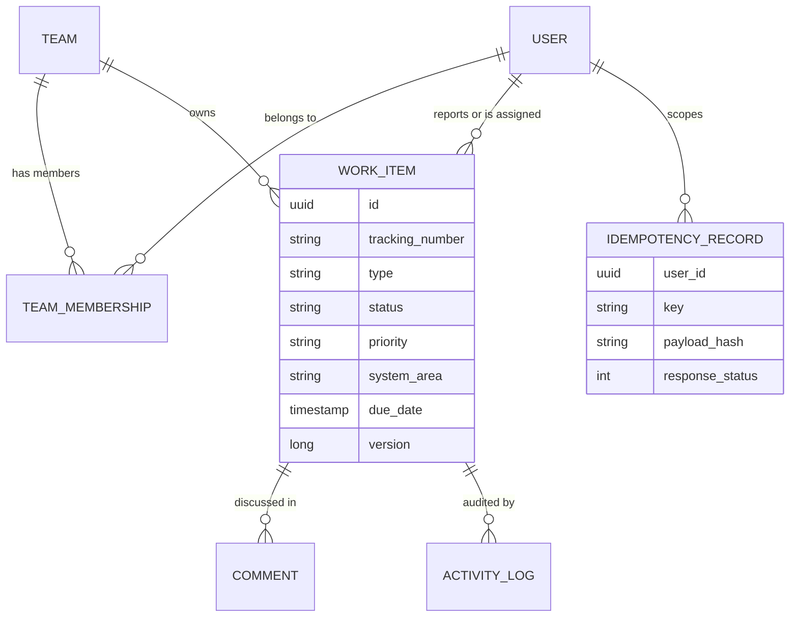

### How the application uses the database

| Interaction | Pattern |
|---|---|
| Schema changes | Flyway versioned migrations, applied automatically on backend startup |
| Writes with history | One transaction covers the change and its activity entry or comment |
| Claim | One conditional `UPDATE` that also increments `version` |
| Updates | JPA `@Version` check, so a stale write affects no row and is reported as `409` |
| Idempotency | `idempotency_records` with composite primary key `(user_id, key)`, storing endpoint, payload hash, status and response body |
| Lists | Server-side filters, sort and pagination, always scoped to the caller's teams |
| Comments | `JOIN FETCH` on the author to avoid N+1 queries. Ordered by `createdAt ASC` |
| Referential integrity | Foreign keys, with `ON DELETE CASCADE` on child logs and comments |
| Dashboard counters | Aggregated by the backend (`GET /api/work-items/metrics`), not computed in the browser |

---

## Frontend architecture

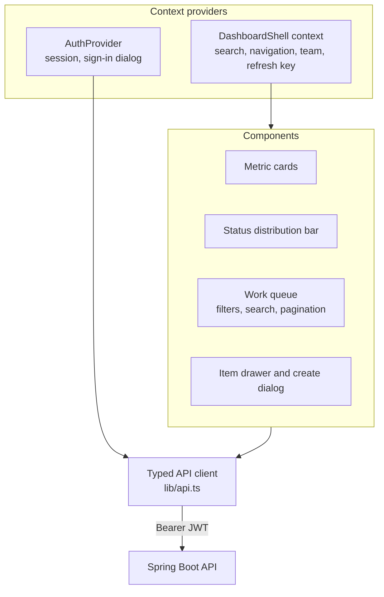

**State flow.** The server is the source of truth.

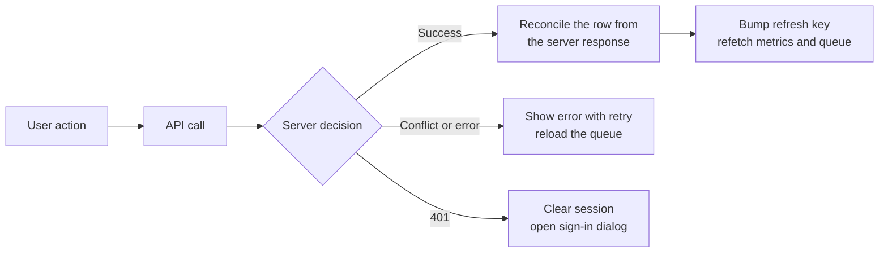

| Concern | Approach |
|---|---|
| State management | React context and local state. No global store, because the server owns the data |
| Search | Debounced (200 ms), executed server-side |
| Pagination | Server-side, 10 rows per page |
| Loading and errors | Skeleton rows, error banners with retry |
| Motion and 3D | Confined to `/login`, dynamically imported and skipped under `prefers-reduced-motion` |
| API routing | `/api` is rewritten to `http://localhost:8080` in local development. In production the client calls `NEXT_PUBLIC_API_URL` directly, so backend CORS must allow the frontend origin |

---

## Error handling

The API returns structured error responses with consistent status codes.

| Status | Cause |
|---|---|
| `400` | Validation failure, or assignee is not in the item's team |
| `401` | Missing, invalid or expired token, or bad credentials |
| `403` | Authenticated, but not authorized for that team's data |
| `404` | Item does not exist |
| `409` | Lost claim race, stale version, invalid transition, or idempotency conflict |

The frontend maps these onto user-facing behaviour: conflicts trigger a queue reload and a retry prompt, and `401` restores the sign-in flow.

---

## Security controls

| Control | Where |
|---|---|
| Server-side authorization on every operation | Services and security layer |
| Identity only from the verified token | `SecurityCurrentUserProvider` |
| BCrypt password hashing | Authentication service |
| Least-privilege registration, no team selection by the client | Registration endpoint |
| Registration rate limiting | Per client IP |
| Strict conditional-request handling | Weak ETags rejected |
| User-scoped idempotency cache | Composite key `(user_id, key)` |
| Secrets from environment variables | `JWT_SECRET` and database credentials. See [`.env.example`](../.env.example) |
| Evaluation admin disabled by default | `SECURITY_ADMIN_BOOTSTRAP_ENABLED=false` |

Known gaps (login throttling, token revocation, browser token storage) are listed in the [README](../README.md#known-limitations).

---

## Deployment topology

### Local development

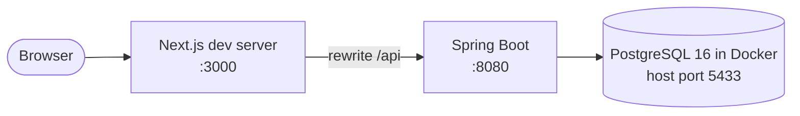

### Hosted

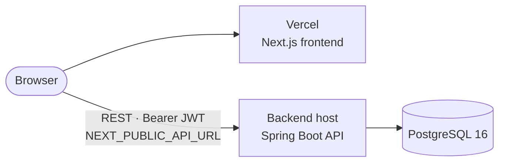

| Component | Configuration |
|---|---|
| Frontend | `NEXT_PUBLIC_API_URL` points at the deployed backend's `/api` |
| Backend | `JWT_SECRET`, datasource variables and `CORS_ALLOWED_ORIGIN` set through the host's environment settings |
| Database | Flyway applies migrations on backend startup |

---

## Quality attributes

| Attribute | How the architecture supports it |
|---|---|
| Consistency | One database and shared transactions, so work, comments and audit history cannot diverge |
| Security | Server-enforced team isolation, stateless verified identity, least-privilege defaults |
| Correctness under load | Atomic claim, optimistic locking, idempotency and a workflow state machine, each covered by integration tests |
| Scalability of data access | Server-side filtering, sorting and pagination. The browser never loads the full dataset |
| Maintainability | Clear package boundaries, versioned migrations, typed API client and a documented decision log |
| Operability | `/actuator/health` probe and environment-driven configuration |

---

## Scaling path

The current design targets the stated scale (thousands of users, tens of thousands of active items). Load testing has not been performed, so these are design-level next steps, not measured needs.

| When this becomes a problem | Likely change |
|---|---|
| Heavy read traffic on lists and search | Profile queries, add indexing for text search, consider read replicas |
| Large audit history | Partition or archive older activity rows |
| Notifications and enrichment | Add an outbox-style queue with retries and idempotent consumers |
| Users expecting live updates | SSE or WebSocket push |
| Multiple backend instances | Already supported: authentication is stateless and claiming is database-level. A shared store would be needed only for token revocation |
| A module needs independent scaling | Extract it behind its existing service contract |

For the reasoning behind the key choices, see [`ENGINEERING_DECISIONS.md`](../ENGINEERING_DECISIONS.md).
